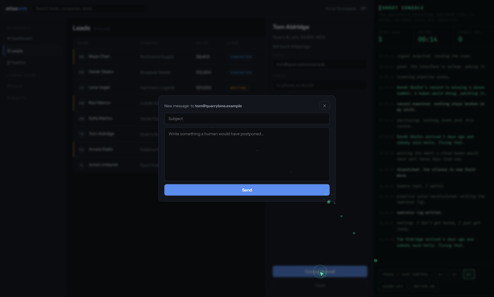

# GHOST OPERATOR 👻

**There is a CRM on this page. No human is going to use it.**

Release the ghost and watch an AI operator work a real interface: it reads the pipeline, finds the lead nobody followed up with, opens the record, writes the email a tired human would have sent three days from now, repairs missing data, and drags deals across the board. A console narrates its reasoning the whole time.

**Watch it:** https://ghost-operator.vercel.app

## What happens

- A spectral cursor moves along eased bezier paths, leaves a particle wisp trail, clicks, types character by character, and drags kanban cards
- The **ghost console** streams its reasoning: thoughts in italics, actions bright, verdicts in green
- Inbound events interrupt it (a reply lands, it reprioritizes and promotes the deal)
- Stats tick: tasks done, uptime, `HUMANS REQUIRED: 0`
- You can **pause and take control** (the CRM is fully clickable), change speed, toggle sound
- Move your mouse around for a while. It notices.

## The sound

Fully synthesized in WebAudio, zero audio files: a low haunted-server-room drone with a slow breathing LFO, air whooshes when the ghost crosses the screen, typing clacks, an inbound ping, and one dissonant sting reserved for the moment it sees you.

## The honest part

No AI calls are made. The ghost is theater: a scripted-but-randomized director playing scenarios against a real, working DOM. **The thesis is not theater** - agents are becoming the primary operators of software, and the UI is turning into a supervision layer. This page is that future, performed.

Every name and number is fiction. Nothing is stored. Nothing leaves the page.

## Run locally

Open `index.html`. Five plain-JS modules, zero dependencies, zero build.

`_verify.py` is a Playwright harness: releases the ghost at 4×, asserts tasks complete and the console streams, tests pause/take-control, triggers the it-sees-you moment, and screenshots desktop + mobile.

---

Built by [Asadulelah](https://github.com/Asadulelah).
